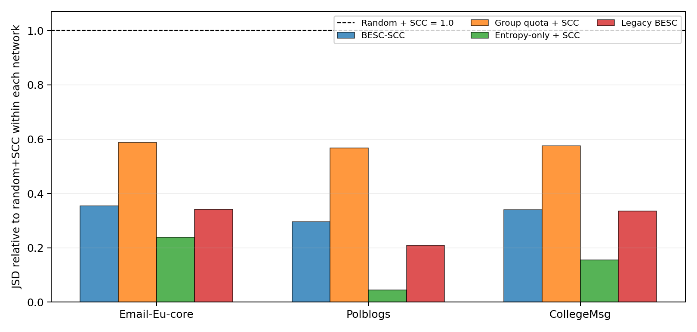

# BESC-SCC — reproducible graph-sparsification prototype

[](src/test_scc_invariants.py)

**Research software by Władysław Błocki.** BESC-SCC (*Bridge-Aware Entropy-Preserving Sparsification with Strongly Connected Component guarantees*) is an exploratory heuristic for **directed, unweighted graphs**. It balances Jensen–Shannon divergence of individual outgoing contact distributions across node groups with degree-retention error. A protected in/out spanning-tree certificate preserves the exact strongly connected component (SCC) partition after edge deletion.

**Status:** experimental code and exploratory results, **not independently audited**, peer-reviewed, or proof of novelty versus all previous sparsifiers. The SCC-preservation construction itself is classical. The methods labeled as baselines are in-house study heuristics, not full implementations of the published state of the art.

## What is in this repository?

```text
src/                 Algorithm and comparison heuristics
scripts/             Data checks, summary consistency and plotting
tests/               Reserved for additional unit tests
data/README.md       Third-party data sources and input file names
results/reference/   Stored exploratory CSV results from 216 runs
figures/             Relative-JSD comparison (PNG + PDF)
docs/                Methodology, limitations and dataset citations
.github/workflows/   Automated tests without external datasets
requirements.txt     Python dependencies
LICENSE              MIT for code, not third-party datasets
CITATION.cff         Software citation metadata
```

### Install

Requires Python 3.10+ (tested locally with Python 3.13; the GitHub Actions workflow uses Python 3.11).

```bash
python -m venv .venv
# Linux/macOS:
source .venv/bin/activate
# Windows PowerShell:
# .venv\Scripts\Activate.ps1
python -m pip install -r requirements.txt
```

Optional acceleration: `python -m pip install -r requirements-optional.txt` (Numba).

### Run tests (without external data)

```bash
python src/test_scc_invariants.py
python scripts/validate_reference.py
python scripts/make_figure.py
```

These tests check structural invariants and internal consistency of stored results; they **do not independently reproduce** all analyses or validate scientific novelty.

### Download data separately

See [data/README.md](data/README.md) for links and exact filenames. The repository intentionally contains **no third-party raw networks**. Place downloaded files in `data/`, then run:

```bash
python scripts/check_inputs.py
```

### Re-run three-network study

```bash
python src/run_besc_scc.py \
  --input-dir data \
  --output-dir results/generated \
  --networks email-Eu-core Polblogs CollegeMsg \
  --trials 3 \
  --rho 0.3 0.5 0.7
```

The full command runs 8 variants × 3 fractions × 3 fixed protection-mask seeds × 3 graphs = **216 runs**. Results are written under `results/generated/`. It can take minutes or longer depending on machine and whether Numba acceleration is installed. No raw inputs are downloaded automatically.

### Observed exploratory results

Across the three fixed networks, BESC-SCC preserved the exact original SCC partition while reducing weighted actor-profile JSD relative to `random_SCC` at 50% retained edges:

| Network | BESC-SCC JSD | Random + SCC JSD | Entropy-only + SCC JSD |
|---|---:|---:|---:|
| email-Eu-core | 0.02600 | 0.07339 | 0.01750 |
| Polblogs | 0.00207 | 0.00703 | 0.00032 |
| CollegeMsg | 0.01908 | 0.05618 | 0.00872 |

These are historical averages over **three protection masks**, not results from independent network samples. The entropy-only ablation has lower JSD but may worsen degree-retention metrics. Do not compare raw JSD across networks with different group definitions as if directly equivalent. Original time stamps and edge weights are discarded in this study.



### License and attribution

Source code and newly written documentation are distributed under MIT (see `LICENSE`). Original datasets must be downloaded from their providers and cited (see [docs/DATA_CITATIONS.md](docs/DATA_CITATIONS.md)). No submission acceptance, DOI, or formal validation is implied.

Research, code development and reporting were AI-assisted. The human author is responsible for reviewing, validating and correcting these materials before public scientific use. See [docs/METHODS_AND_LIMITATIONS.md](docs/METHODS_AND_LIMITATIONS.md).
